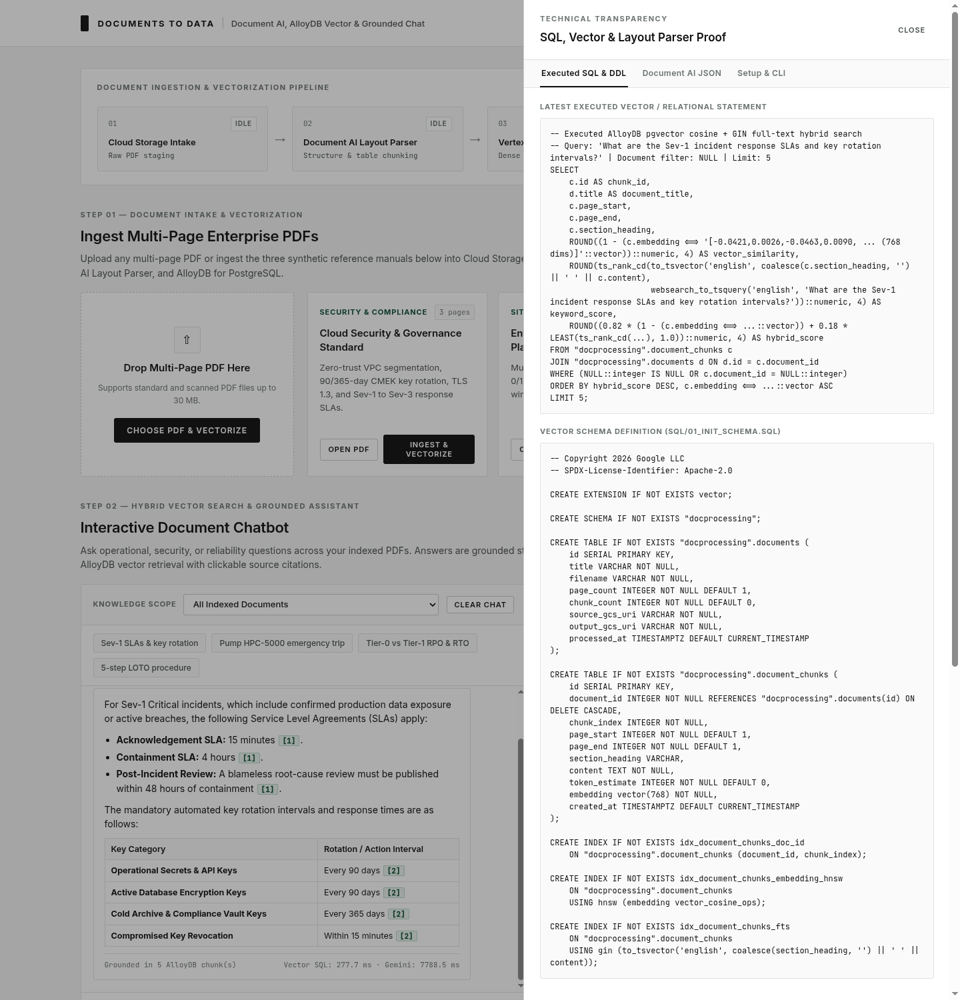

# From Documents to Data: Document AI, AlloyDB Vector & Grounded Chat

Open-source reference implementation accompanying the Google Cloud blog post:
**[From Documents to Data: A Technical Blueprint Using Document AI and AlloyDB](https://medium.com/google-cloud/from-documents-to-data-a-technical-blueprint-using-document-ai-and-alloydb-8e9a0179c0b4)**

This repository turns multi-page enterprise PDFs into layout-aware semantic chunks stored with dense vector embeddings in **AlloyDB for PostgreSQL** (`pgvector`), powering a citation-grounded **Gemini** assistant. It includes:

- **Interactive FastAPI Web Application & Minimalist UI** featuring a 4-node live pipeline strip, drag-and-drop multi-page PDF ingestion, a two-column **Interactive Document Chatbot** with inline clickable `[1]` source citations, retrieved vector evidence cards, an inspectable chunk ledger, and a **View SQL & Proof** transparency drawer.
- **Standalone Batch & Online CLI Pipeline** (`scripts/batch_pipeline.py`) supporting synchronous processing, asynchronous Cloud Storage batch ingestion, and terminal hybrid vector Q&A.
- **Synthetic Multi-Page Specimen Generator** (`scripts/generate_sample_pdfs.py`) producing 3 clean, three-page synthetic enterprise PDFs (`sample_docs/`) with zero real PII.
- **Automated Google Cloud Setup Helper** (`scripts/setup_gcp.sh`) and **Cloud Run** container configuration (`Dockerfile`).




---

## Architecture

```mermaid
flowchart LR
    Intake["Multi-Page PDF Intake"] --> GCSIn["Cloud Storage Input Bucket"]
    GCSIn --> DocAI["Document AI Layout Parser"]
    DocAI --> GCSOut["Cloud Storage JSON Output"]
    GCSOut --> Chunk["Layout-Aware Chunking"]
    Chunk --> Embed["Vertex AI Embeddings"]
    Embed --> AlloyDB["AlloyDB for PostgreSQL (pgvector HNSW + GIN)"]
    AlloyDB --> Chat["Grounded Gemini Flash Chatbot & SQL Proof UI"]
```



### Repository Structure

```text
docai-alloydb-blueprint/
├── app/
│   ├── main.py              # FastAPI server, ingestion, hybrid search & chat endpoints
│   ├── config.py            # Typed environment settings loader
│   ├── docai_service.py     # Cloud Storage & Document AI Layout Parser integration
│   ├── chunking.py          # Layout-aware chunk extraction & heading inference
│   ├── rag_service.py       # Vertex AI Embeddings & Gemini grounded answer generation
│   ├── db.py                # AlloyDB for PostgreSQL persistence & pgvector hybrid SQL
│   └── static/
│       ├── index.html       # Guided 3-step PDF ingestion & chatbot web UI
│       ├── styles.css       # Minimalist light architectural theme
│       └── app.js           # Live pipeline UI, markdown citation chat & proof drawer
├── scripts/
│   ├── setup_gcp.sh         # Enable APIs, create buckets & Layout Parser processor
│   ├── batch_pipeline.py    # Standalone CLI for online/batch ingestion & Q&A
│   └── generate_sample_pdfs.py  # Generates 3 multi-page synthetic enterprise PDFs
├── sql/
│   └── 01_init_schema.sql   # pgvector extension, documents & document_chunks DDL
├── sample_docs/             # Synthetic 3-page enterprise PDFs (no real PII)
├── tests/                   # Unit, FastAPI endpoint & anti-mocking hygiene tests
├── Dockerfile               # Cloud Run ready container image on port 8080
├── requirements.txt
├── .env.example
├── CONTRIBUTING.md
└── LICENSE                  # Apache License 2.0
```

---

## Prerequisites

1. **Google Cloud Project** with billing enabled and permissions for **Cloud Storage**, **Document AI**, **Vertex AI**, and **AlloyDB for PostgreSQL**.
2. **AlloyDB for PostgreSQL** cluster and primary instance provisioned in your VPC (or reachable via **AlloyDB Auth Proxy**).
3. **Google Cloud CLI (`gcloud`)** authenticated with Application Default Credentials:
   ```bash
   gcloud auth login
   gcloud auth application-default login
   ```
4. **Python** (`3.11+` recommended).

---

## Quickstart

### 1. Create Virtual Environment & Install Dependencies

```bash
python3 -m venv .venv
source .venv/bin/activate
pip install -r requirements.txt
```

### 2. Provision Buckets, Document AI Layout Parser & Auth Proxy

Run the helper script to enable `documentai.googleapis.com`, `alloydb.googleapis.com`, `storage.googleapis.com`, and `aiplatform.googleapis.com`, create input/output **Cloud Storage** buckets, create (or reuse) a `LAYOUT_PARSER_PROCESSOR`, and download **AlloyDB Auth Proxy**:

```bash
export GCP_PROJECT_ID="<YOUR_PROJECT_ID>"
bash scripts/setup_gcp.sh
```

Copy `.env.example` to `.env` and populate the printed values (`GCP_PROJECT_ID`, `DOCAI_PROCESSOR_ID`, `GCS_INPUT_BUCKET`, `GCS_OUTPUT_BUCKET`, and your AlloyDB password):

```bash
cp .env.example .env
```

### 3. Connect to AlloyDB for PostgreSQL

In a separate terminal, start **AlloyDB Auth Proxy** against your cluster instance:

```bash
./alloydb-auth-proxy \
  projects/<YOUR_PROJECT_ID>/locations/us-central1/clusters/<CLUSTER_ID>/instances/<INSTANCE_ID> \
  --port 5432
```

Initialize the `pgvector` schema manually if desired (the FastAPI app and batch CLI also run this idempotently):

```bash
psql -h 127.0.0.1 -p 5432 -U postgres -d postgres -f sql/01_init_schema.sql
```

### 4. Launch the Web Application

```bash
uvicorn app.main:app --host 0.0.0.0 --port 8080 --reload
```

Open `http://localhost:8080` in your browser:
1. Click **Ingest All 3 Sample PDFs** (or upload any multi-page PDF) to stage, layout-parse, vectorize, and store chunks in AlloyDB.
2. Ask questions in **Step 02 — Interactive Document Chatbot** and click inline `[1]` citation badges to inspect retrieved chunks and similarity scores.
3. Open **View SQL & Proof** in the top right to inspect the exact `pgvector` hybrid search query, schema DDL, and Document AI Layout Parser output.

---

## Standalone Batch & Online CLI Usage

Run ingestion and grounded Q&A directly from the terminal:

```bash
# Synchronous per-document ingestion + grounded query
python scripts/batch_pipeline.py --input-dir sample_docs --mode online \
  --query "What are the Sev-1 incident response SLAs and key rotation intervals?"

# Asynchronous Document AI batch processing via Cloud Storage prefixes
python scripts/batch_pipeline.py --input-dir sample_docs --mode batch

# Query already indexed documents without re-ingesting
python scripts/batch_pipeline.py --query-only \
  --query "What vibration level triggers an emergency trip on Pump HPC-5000?"
```

---

## Database Schema Reference

Defined in `sql/01_init_schema.sql`:

- **`"docprocessing".documents`**: Tracks ingested PDF metadata (`title`, `filename`, `page_count`, `chunk_count`, `source_gcs_uri`, `output_gcs_uri`, `processed_at`).
- **`"docprocessing".document_chunks`**: Stores layout-parsed sections (`document_id`, `chunk_index`, `page_start`, `page_end`, `section_heading`, `content`, `token_estimate`, and 768-dimensional `embedding vector(768)`).
- **Hybrid Search Indexes**:
  - `idx_document_chunks_embedding_hnsw` (`HNSW` using `vector_cosine_ops`) for semantic cosine retrieval (`<=>`).
  - `idx_document_chunks_fts` (`GIN` on `to_tsvector('english', ...)`) combined with `ts_rank_cd` for exact keyword & code matching.

---

## Synthetic Multi-Page Sample PDFs

`sample_docs/` contains three 3-page synthetic enterprise PDFs generated by `scripts/generate_sample_pdfs.py`:

| File | Category | Pages | Grounded Topics Covered |
| :--- | :--- | :--- | :--- |
| `Cloud_Security_and_Governance_Standard.pdf` | Security & Compliance | 3 | Zero-trust VPC perimeters, CMEK 90/365-day rotation, TLS 1.3, Sev-1/2/3 SLA table |
| `Industrial_Equipment_Maintenance_SOP.pdf` | Manufacturing Operations | 3 | Coolant pump `HPC-5000` specs, ISO 10816 vibration zones, thermal trips, 5-step LOTO |
| `Enterprise_Platform_Reliability_Playbook.pdf` | Site Reliability | 3 | Multi-region HA, Tier-0/1/2 RPO & RTO matrix, 35-day PITR & change-freeze windows |

To regenerate these specimens at any time:

```bash
python scripts/generate_sample_pdfs.py
```

---

## Deploying to Cloud Run

Build and deploy the container on port `8080`, attaching your VPC connector (or serverless VPC egress) so **Cloud Run** can reach your **AlloyDB for PostgreSQL** private IP:

```bash
gcloud run deploy docai-alloydb-blueprint \
  --source . \
  --region us-central1 \
  --port 8080 \
  --set-env-vars GCP_PROJECT_ID="<YOUR_PROJECT_ID>",DOCAI_LOCATION="us",DOCAI_PROCESSOR_ID="<YOUR_LAYOUT_PROCESSOR_ID>",GCS_INPUT_BUCKET="<YOUR_INPUT_BUCKET>",GCS_OUTPUT_BUCKET="<YOUR_OUTPUT_BUCKET>",DB_HOST="<ALLOYDB_PRIVATE_IP>",DB_PORT="5432",DB_NAME="postgres",DB_USER="postgres"
```

Inject `DB_PASSWORD` securely via Secret Manager (`--set-secrets DB_PASSWORD=alloydb-password:latest`) for production deployments.

---

## Running Tests

```bash
pytest -v
```

Tests verify multi-page PDF generation, Document AI Layout Parser chunk extraction and fallback splitting, FastAPI endpoint behavior, open-source IP/font hygiene, version-agnostic UI/doc naming, and strict zero-mocking enforcement.

---

## License & Disclaimer

Licensed under the Apache License, Version 2.0. See [LICENSE](LICENSE) for full text and [CONTRIBUTING.md](CONTRIBUTING.md) for contribution guidelines.

> **Disclaimer:** This repository is an open-source reference implementation accompanying the technical blog post and is not an officially supported Google product.
