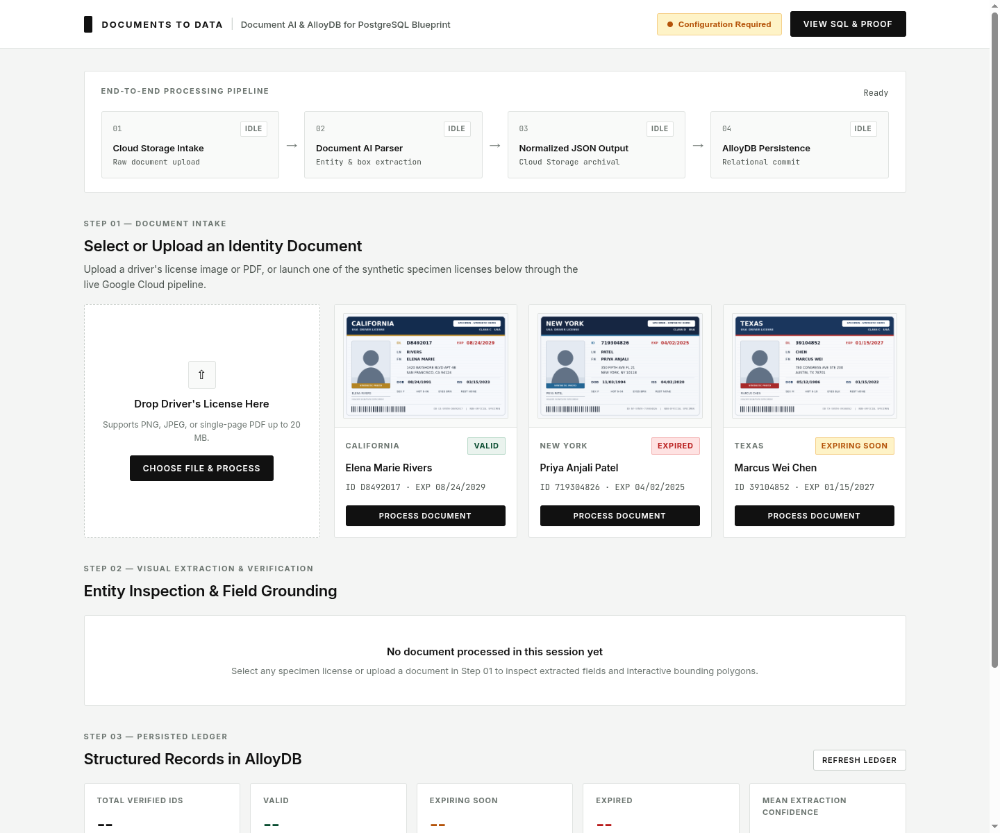
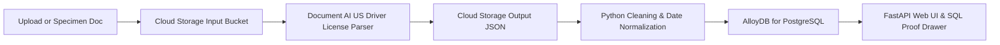

# From Documents to Data: Document AI & AlloyDB for PostgreSQL Blueprint

Open-source reference implementation accompanying the Google Cloud blog post:
**[From Documents to Data: A Technical Blueprint Using Document AI and AlloyDB](https://medium.com/google-cloud/from-documents-to-data-a-technical-blueprint-using-document-ai-and-alloydb-8e9a0179c0b4)**

This repository turns unstructured identity documents (PNG, JPEG, and PDF US Driver's Licenses) into normalized, queryable relational records stored in **AlloyDB for PostgreSQL**, using **Cloud Storage** and **Document AI** (`US_DRIVER_LICENSE_PROCESSOR`). It includes:

- **Interactive FastAPI Web Application & Minimalist UI** with a live 4-stage pipeline strip, interactive SVG bounding-box inspection over the document, compliance status filtering, and a **View SQL & Proof** transparency drawer.
- **Standalone Batch & Online CLI Pipeline** (`scripts/batch_pipeline.py`) supporting both synchronous single-document extraction and asynchronous Cloud Storage batch processing.
- **Synthetic Specimen Generator** (`scripts/generate_sample_licenses.py`) producing 100% synthetic sample US Driver's Licenses (`sample_docs/`) for immediate testing without real PII.
- **Automated Google Cloud Setup Helper** (`scripts/setup_gcp.sh`) and **Cloud Run** container configuration (`Dockerfile`).




---

## Architecture



### Repository Structure

```text
docai-alloydb-blueprint/
├── app/
│   ├── main.py              # FastAPI server and REST API endpoints
│   ├── config.py            # Typed environment settings loader
│   ├── docai_service.py     # Cloud Storage & Document AI client integration
│   ├── cleaning.py          # Text cleaning, date parsing & bounding box mapping
│   ├── db.py                # AlloyDB for PostgreSQL connection, DDL & SQL queries
│   └── static/
│       ├── index.html       # Guided 3-step minimalist web application
│       ├── styles.css       # Light architectural theme
│       └── app.js           # Live pipeline UI, SVG bounding boxes & proof drawer
├── scripts/
│   ├── setup_gcp.sh         # Enable APIs, create buckets & Document AI processor
│   ├── batch_pipeline.py    # Standalone CLI for online or batch ingestion
│   └── generate_sample_licenses.py  # Generates synthetic PNG/PDF specimens
├── sql/
│   └── 01_init_schema.sql   # DDL for "docprocessing".driverslicense
├── sample_docs/             # Synthetic specimen driver's licenses (no real PII)
├── tests/                   # Unit, FastAPI endpoint & anti-mocking hygiene tests
├── Dockerfile               # Cloud Run ready container image on port 8080
├── requirements.txt
├── .env.example
└── LICENSE                  # Apache License 2.0
```

---

## Prerequisites

1. **Google Cloud Project** with billing enabled and permissions for **Cloud Storage**, **Document AI**, and **AlloyDB for PostgreSQL**.
2. **AlloyDB for PostgreSQL** cluster and primary instance provisioned in your VPC (or accessible via **AlloyDB Auth Proxy**).
3. **Google Cloud CLI (`gcloud`)** authenticated with Application Default Credentials:
   ```bash
   gcloud auth login
   gcloud auth application-default login
   ```
4. **Python** (`3.11+` recommended).

---

## Quickstart

### 1. Create Virtual Environment & Install Dependencies

```bash
python3 -m venv .venv
source .venv/bin/activate
pip install -r requirements.txt
```

### 2. Provision Buckets, Document AI Processor & Auth Proxy

Run the helper script to enable `documentai.googleapis.com`, `alloydb.googleapis.com`, and `storage.googleapis.com`, create input/output **Cloud Storage** buckets, create (or reuse) a `US_DRIVER_LICENSE_PROCESSOR`, and download **AlloyDB Auth Proxy**:

```bash
export GCP_PROJECT_ID="<YOUR_PROJECT_ID>"
bash scripts/setup_gcp.sh
```

Copy `.env.example` to `.env` and populate the printed values (`GCP_PROJECT_ID`, `DOCAI_PROCESSOR_ID`, `GCS_INPUT_BUCKET`, `GCS_OUTPUT_BUCKET`, and your AlloyDB password):

```bash
cp .env.example .env
```

### 3. Connect to AlloyDB for PostgreSQL

In a separate terminal, start **AlloyDB Auth Proxy** against your cluster instance:

```bash
./alloydb-auth-proxy \
  projects/<YOUR_PROJECT_ID>/locations/us-central1/clusters/<CLUSTER_ID>/instances/<INSTANCE_ID> \
  --port 5432
```

Initialize the schema manually if desired (the FastAPI app and batch CLI also run this idempotently):

```bash
psql -h 127.0.0.1 -p 5432 -U postgres -d postgres -f sql/01_init_schema.sql
```

### 4. Launch the Web Application

```bash
uvicorn app.main:app --host 0.0.0.0 --port 8080 --reload
```

Open `http://localhost:8080` in your browser. Click **Process Document** on any of the synthetic specimen licenses or upload your own PNG/JPEG/PDF file.

---

## Standalone Batch & Online CLI Usage

Run the blog's end-to-end ingestion script directly from the terminal:

```bash
# Synchronous per-document processing
python scripts/batch_pipeline.py --input-dir sample_docs --mode online

# Asynchronous Document AI batch processing via Cloud Storage prefixes
python scripts/batch_pipeline.py --input-dir sample_docs --mode batch
```

---

## Database Schema Reference

Defined in `sql/01_init_schema.sql`:

```sql
CREATE SCHEMA IF NOT EXISTS "docprocessing";

CREATE TABLE IF NOT EXISTS "docprocessing".driverslicense (
    id SERIAL PRIMARY KEY,
    dl_number VARCHAR,
    given_name VARCHAR,
    surname VARCHAR,
    address VARCHAR,
    dob DATE,
    expiration_date DATE,
    issue_date DATE,
    source_gcs_uri VARCHAR,
    output_gcs_uri VARCHAR,
    avg_confidence NUMERIC(5, 4),
    raw_entities JSONB,
    processed_at TIMESTAMPTZ DEFAULT CURRENT_TIMESTAMP
);
```

- `dl_number`, `given_name`, `surname`, `address`, `dob`, `expiration_date`, `issue_date`: Core structured fields from the blueprint.
- `source_gcs_uri`, `output_gcs_uri`, `avg_confidence`, `raw_entities`, `processed_at`: Operational provenance and audit columns used by the UI and proof drawer.

---

## Synthetic Sample Documents

`sample_docs/` contains three 100% synthetic specimen US Driver's Licenses (both `.png` and `.pdf`) generated by `scripts/generate_sample_licenses.py`:

| File | Specimen Holder | Expected Compliance State |
| :--- | :--- | :--- |
| `sample_dl_california_valid.png` | Elena Marie Rivers (`D8492017`) | Valid (`EXP 08/24/2029`) |
| `sample_dl_texas_expiring.png` | Marcus Wei Chen (`39104852`) | Expiring Soon (`EXP 01/15/2027`) |
| `sample_dl_newyork_expired.png` | Priya Anjali Patel (`719304826`) | Expired (`EXP 04/02/2025`) |

To regenerate these specimens at any time:

```bash
python scripts/generate_sample_licenses.py
```

---

## Deploying to Cloud Run

Build and deploy the container on port `8080`, attaching your VPC connector (or serverless VPC egress) so **Cloud Run** can reach your **AlloyDB for PostgreSQL** instance:

```bash
gcloud run deploy docai-alloydb-blueprint \
  --source . \
  --region us-central1 \
  --port 8080 \
  --set-env-vars GCP_PROJECT_ID="<YOUR_PROJECT_ID>",DOCAI_LOCATION="us",DOCAI_PROCESSOR_ID="<YOUR_PROCESSOR_ID>",GCS_INPUT_BUCKET="<YOUR_INPUT_BUCKET>",GCS_OUTPUT_BUCKET="<YOUR_OUTPUT_BUCKET>",DB_HOST="<ALLOYDB_PRIVATE_IP>",DB_PORT="5432",DB_NAME="postgres",DB_USER="postgres"
```

Inject `DB_PASSWORD` securely via Secret Manager (`--set-secrets DB_PASSWORD=alloydb-password:latest`) for production deployments.

---

## Running Tests

```bash
pytest -v
```

Tests verify text/address normalization, date parsing, Document AI entity mapping and confidence tie-breaking, synthetic specimen integrity, FastAPI endpoint behavior, and open-source / zero-mocking compliance.

---

## License & Disclaimer

Licensed under the Apache License, Version 2.0. See [LICENSE](LICENSE) for full text and [CONTRIBUTING.md](CONTRIBUTING.md) for contribution guidelines.

> **Disclaimer:** This repository is an open-source reference implementation accompanying the technical blog post and is not an officially supported Google product.
